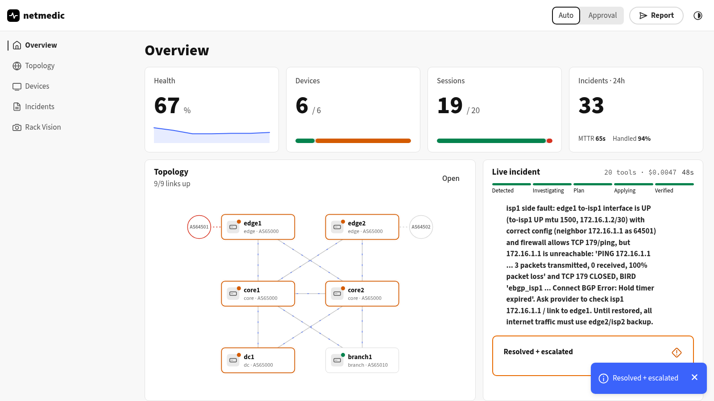
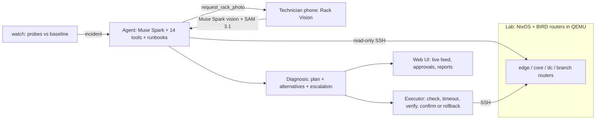

# netmedic

> An on-call network engineer that never sleeps: it **detects** network incidents, **investigates** them
> with real router tools, **fixes** what it safely can — with automatic rollback — and, when a cable is
> the problem, **asks the technician for a photo** and reads the rack with Meta's vision models.

Built for the **Meta Global AI Developer Hackathon** (Oct 27 – Nov 4, 2026), track *Build for Your World*.
**Everything in this repository was written during the hackathon** (first commit: Oct 27).



## Why

Network outages are still debugged by a human reading `show` commands at 3 AM. The fix is often
small (a typo in a filter, a wrong MTU, a cable), but finding it takes an hour, and touching a
production router without a safety net is how small outages become big ones. netmedic does the
investigation in about a minute and only changes a router through a verified, reversible path.

## What it does

1. **Detect** — `netmedic watch` probes every router every 5 s (BGP/OSPF sessions, best paths,
   reachability, DNS) and compares with a learned baseline. A symptom must persist two probes.
2. **Investigate** — Muse Spark runs a tool-calling loop over 14 read-only, validated tools
   (`birdc`, interfaces, routes, ping, traceroute, DNS, nftables…), guided by YAML runbooks,
   checking both ends of every link, and submits a structured diagnosis: root cause, evidence,
   an ordered plan (one fix per root cause) and alternatives.
3. **Fix safely** — each step is a typed action applied with a backup, `birdc configure check`,
   `configure timeout` (BIRD reverts by itself), typed post-checks, then `confirm` — or an
   automatic rollback. Low-risk steps run on their own in *auto* mode; everything else waits
   for a human approval in the web UI.
4. **Escalate the physical world** — when a link has no carrier and nothing in the config explains
   it, the agent calls `request_rack_photo`: the technician gets the request on their phone, points
   it at the rack, and **Rack Vision** (Muse Spark vision + SAM 3.1) returns the findings to the
   agent, which escalates the exact port to re-plug.
5. **Report** — every incident ends with a Markdown root-cause report and its full timeline.

## Meta models

| Model | Where | Why |
|---|---|---|
| **Muse Spark 1.3** (tool calling, structured output) | `agent.py` | Investigation loop and diagnosis. An escalation ladder retries a failed incident with higher reasoning effort, then **Muse Wonder** |
| **Muse Spark vision** | `vision.py` | Reads the rack photo with the live network state as context, and follows a cable from a tapped port |
| **SAM 3.1** | `vision.py` | Live port segmentation on the phone video (empty / plugged), and a cross-check of every "empty port" claim made by Spark, which hallucinated under prompt pressure before this check |

Cost per incident: **$0.002–0.016** with the contributor tier and 40–70 % cached tokens.

## Architecture



- **Backend**: Python 3.12, `asyncssh`, FastAPI + server-sent events, Pydantic models.
- **Web UI**: React + Adobe Spectrum 2 (dashboard, topology, incidents, approvals) and a mobile
  Rack Vision page with an AR-style overlay (iPhone Safari, HTTPS on the LAN with a local CA).
- **Lab**: 8 NixOS VMs running BIRD (OSPF, iBGP route reflectors, dual-homed upstreams, a branch),
  a chaos script with realistic faults, and a virtual patch cord (`lab.sh cable … off`) that
  produces a real NO-CARRIER.

## Evaluation

`netmedic eval` replays every chaos scenario through the real watcher, in auto mode, and measures
whether the network gets back to its baseline, how fast, and at what cost.

EVAL_TABLE

## Quick start

```sh
nix develop                                # python 3.12, uv, sops, node
uv sync && (cd frontend && npm ci && npm run build)
lab/lab.sh use enterprise && lab/lab.sh up # 8 router VMs
META_API_KEY=... uv run netmedic watch     # http://127.0.0.1:8080
lab/chaos.sh failover-broken               # or: lab/chaos.sh list
```

- `netmedic watch --lan` serves the UI over HTTPS on the LAN and prints a QR code for the phone.
- `lab/chaos.sh cable-unplug` pulls a patch cord: the agent asks for a Rack Vision photo.
- `netmedic fix "BGP between edge1 and isp1 is down"` investigates and fixes a described problem.
- `netmedic eval --runs 2` reproduces the table above.

## Safety

- The model never runs commands: every tool maps validated arguments to a fixed argv.
- Changes only touch `/var/lib/netagent/` (the Nix-generated base config is read-only), through
  typed actions with `configure check`, `configure timeout` and automatic rollback.
- Each plan step is verified on its own; a failed step is rolled back alone.
- An incident that fails several times, or whose cause is outside our control (provider, cable),
  is escalated to a human with the evidence, and its symptoms are not re-investigated in a loop.

## Repository

| Path | |
|---|---|
| `src/netmedic/` | watcher, agent, tools, executor, Rack Vision, web server |
| `frontend/` | React + Spectrum 2 UI (built into `src/netmedic/web`) |
| `runbooks/` | YAML runbooks given to the agent |
| `lab/` | NixOS router VMs, topologies, chaos scenarios |
| `reports/` | incident reports and eval results |
