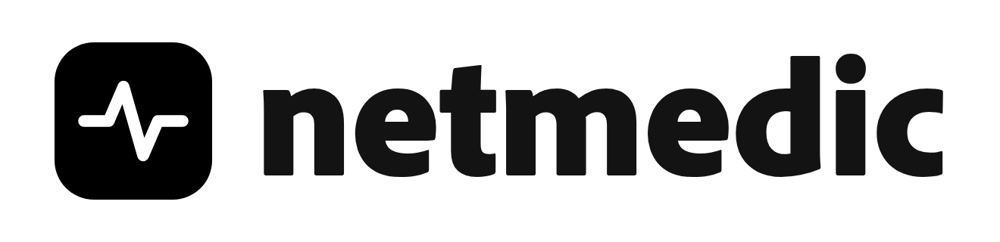
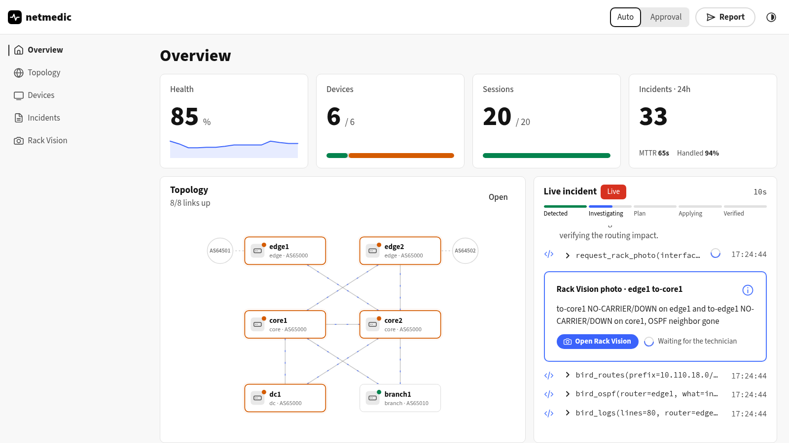
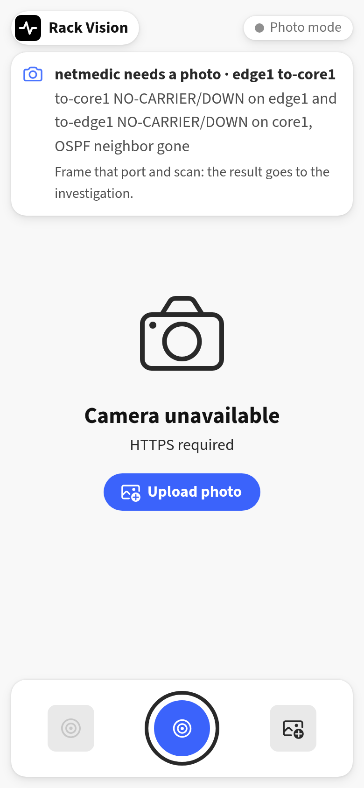

<p align="center">
  <picture>
    <source media="(prefers-color-scheme: dark)" srcset="docs/banner-dark.png">
    
  </picture>
</p>

<p align="center">
  <b>An AI on-call network engineer.</b><br>
  It detects incidents, investigates them with real router tools, fixes what it safely can — with automatic rollback —<br>
  and when the problem is a cable, it asks the technician for a photo and reads the rack.
</p>

<p align="center">
  
  
  
  
  
  
</p>

<p align="center">
  <a href="#demo">Demo</a> ·
  <a href="#how-it-works">How it works</a> ·
  <a href="#results">Results</a> ·
  <a href="#quick-start">Quick start</a> ·
  <a href="docs/architecture.md">Architecture</a>
</p>


## Why

Network outages are still debugged by a person reading `show` commands at 3 AM. The fix is often
small — a typo in a filter, a wrong MTU, a pulled cable — but finding it takes an hour, and
touching a production router without a safety net is how small outages become big ones.

netmedic finds the root cause in about a minute, changes a router only through a verified and
reversible path, and hands a human exactly what it cannot fix itself.

## Demo

▶ **3-minute demo video: coming soon.**

## How it works

| | |
|---|---|
| **1. Detect** | Every 5 s, all routers are probed in parallel — BGP, OSPF, best paths, reachability, DNS — and compared with a baseline learned on the healthy network. Silent failures (routes lost while every session stays up) are caught too. |
| **2. Investigate** | **Muse Spark** runs a tool-calling loop over 14 validated, read-only tools (`birdc`, interfaces, routes, ping, traceroute, DNS, nftables…), guided by YAML runbooks, checking both ends of every link. It submits a structured diagnosis: root cause, evidence, an ordered plan with one fix per root cause, alternatives, and an escalation for what is not ours to fix. |
| **3. Fix safely** | Each step is a typed action with typed checks: snapshot, `birdc configure check`, `configure timeout` (BIRD reverts on its own), verify, then `confirm` — or automatic rollback. Low-risk steps run alone in *auto* mode; the rest wait for an approval in the UI. |
| **4. See the rack** | When a link has no carrier and nothing in the config explains it, the agent calls `request_rack_photo`. The technician's phone shows the request; **Muse Spark vision** and **SAM 3.1** read the photo and the findings go back to the agent, which escalates the exact port to re-plug. |
| **5. Report** | Every incident ends with a root-cause report: evidence, actions, checks, rollbacks, escalation, cost. |

<p align="center">
  
  &nbsp;
  
</p>

## Built with Meta AI

| Model | Used for |
|---|---|
| **Muse Spark 1.3** | The investigation loop: parallel tool calls, runbooks, structured diagnosis with a multi-step plan. A failed incident is retried with higher reasoning effort. |
| **Muse Wonder** | Last tier of the escalation ladder for incidents Spark could not resolve. |
| **Muse Spark vision** | Reads the rack photo with the live network state as context (symptoms, expected cabling), and follows a cable from a tapped port. |
| **SAM 3.1** | Live port segmentation on the phone video (empty / plugged), and a cross-check of every "empty port" claim — added after catching Spark seeing the empty port it was told to look for. |

A typical incident costs **$0.002–0.016** (contributor tier, 40–70 % cached tokens).

## Results

`netmedic eval` replays every chaos scenario of the enterprise lab through the real watcher, in
auto mode, and checks that the network is back to its baseline within 5 minutes.

| Scenario | What breaks | Success | Resolve (median) | Cost/run |
|---|---|---|---|---|
| failover-broken | ISP outage + latent typo in the backup filter | 2/2 | 71 s | $0.004 |
| meltdown | three faults at once | 2/2 | 109 s | $0.007 |
| ospf-mtu | MTU mismatch, OSPF stuck in ExStart | 2/2 | 83 s | $0.008 |
| rr-client | every `rr client` dropped on both reflectors | 2/2 | 252 s | $0.014 |
| branch-limit | import limit hit on the branch session | 2/2 | 45 s | $0.004 |
| dns-service / dns-firewall | DNS stopped / blocked on dc1 | 4/4 | 53–58 s | $0.002–0.003 |
| nexthop-self | `next hop self` removed on edge1 | 1/2 | 195 s | $0.011 |

**15/16 runs resolved (94 %)**, detection in 10–15 s. The one failure taught us something: a
fix passed its checks while also renaming a BGP session — the executor now refuses that.
The physical `cable-unplug` scenario is measured separately: photo requested 8–18 s after
detection, escalated with the right port in under a minute, 4/4.

Details and methodology: [docs/evaluation.md](docs/evaluation.md).

## Quick start

```sh
nix develop && uv sync                     # Python 3.12, uv, sops, Node
lab/lab.sh use enterprise && lab/lab.sh up # 8 BIRD routers in QEMU
export META_API_KEY=...
uv run netmedic watch                      # http://127.0.0.1:8080
lab/chaos.sh failover-broken               # break something
```

`lab/chaos.sh list` shows every scenario; `lab/chaos.sh cable-unplug` triggers the Rack Vision
flow; `netmedic watch --lan` serves the UI over HTTPS with a QR code for the phone.
Full guide: [docs/setup.md](docs/setup.md).

## Safety by design

- The model never writes commands: every tool maps validated arguments to a fixed argv.
- Changes only touch `/var/lib/netagent/`; the Nix-generated base configuration is read-only.
- BIRD changes go through `configure check` and `configure timeout`, so a crash mid-change
  still reverts; every other action records how to undo itself.
- Each plan step is verified on its own; a failed step is rolled back alone.
- What is outside our control — a provider, a cable — is escalated with the evidence and not
  re-investigated in a loop.

## Documentation

| | |
|---|---|
| [Architecture](docs/architecture.md) | detection, agent, tools, executor, events, UI |
| [Rack Vision](docs/rack-vision.md) | live ports, deep scan, SAM cross-check, photo requests, phone setup |
| [Lab](docs/lab.md) | topologies, chaos scenarios, virtual patch cords |
| [Evaluation](docs/evaluation.md) | method and full results |
| [Setup](docs/setup.md) | install, configuration, commands, HTTP API |
| [Sample incident report](docs/sample-report.md) | what netmedic writes after an incident |

## Hackathon

Built for the **Meta Global AI Developer Hackathon** (Cerebral Valley, Oct 27 – Nov 4, 2026),
track *Build for Your World*. **Everything in this repository was written during the hackathon** —
the first commit is from Oct 27, and the commit history shows the progression.
