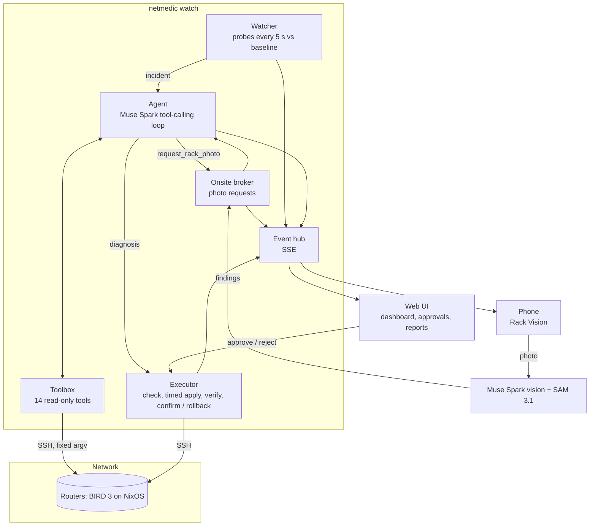

# Architecture

netmedic is one Python process (`netmedic watch`) plus a web UI. It watches the network, opens an
incident when something stays broken, lets Muse Spark investigate with read-only tools, applies
the resulting plan through a verified and reversible executor, and reports.

## 1. Detection — `watcher.py`

Every `watch.interval` (5 s) all routers are probed in parallel over SSH:

| Probe | Symptom when it differs from the baseline |
|---|---|
| BGP | a session is not Established |
| OSPF | a neighbour learned while healthy is missing or not Full |
| Best paths | the best route to a prefix is missing or comes from another protocol (catches silent failures such as an import filter dropping routes while every session stays up) |
| Reachability | a router cannot ping another router's loopback or an internet target |
| DNS | a configured name does not resolve |

The baseline is learned on a healthy network. A symptom must persist `confirm_polls` (2) probes
before an incident opens. After an incident the watcher lets routing settle (`settle`, 20 s),
retries at most `max_attempts` times per set of symptoms (moving up the model ladder), then
escalates. Symptoms an incident declared outside our control (provider, cable) are acknowledged
and not re-investigated in a loop; they are watched until they clear.

External alerts (Alertmanager webhook or `{"summary": "..."}`) enter through `POST /api/alerts`,
and the web UI has a *Report* button that does the same.

## 2. Investigation — `agent.py`, `tools.py`, `runbooks/`

The agent is a tool-calling loop on **Muse Spark 1.3**. The system prompt contains the inventory,
the network design notes and the runbooks; the incident text lists the symptoms.

- **14 read-only tools**: BIRD protocols / protocol detail / routes / OSPF / exported routes /
  config / logs, interfaces, kernel routes, ping (with DF for MTU tests), traceroute, TCP check,
  DNS lookup, nftables ruleset. Each tool validates its arguments and builds a fixed argv: the
  model never writes a command.
- **Runbooks** (YAML): BGP session down, OSPF adjacency, iBGP route reflection, upstream failover.
  The model follows them when they match and deviates when the evidence points elsewhere.
- **Parallel calls**: independent checks run in the same turn; most incidents take 3–4 rounds.
- **Structured output**: the loop ends with `submit_diagnosis` — summary, root cause, ranked
  hypotheses with evidence, an ordered **plan** (one remediation per independent root cause),
  alternatives considered, and an **escalation** for what we cannot fix ourselves.
- **Model ladder** (`netmedic.yaml`): attempt 1 uses Spark with low reasoning effort, a retry uses
  high effort, the last resort is **Muse Wonder**.

## 3. Remediation — `remediate.py`, `models.py`

Remediations are lists of **typed actions**, each with **typed checks**:

| Actions | Checks |
|---|---|
| `edit_bird_config` (exact find/replace in `/var/lib/netagent/*.conf`) | `bgp_established` |
| `set_interface` (up/down, MTU) | `route_present` (optionally via a protocol) |
| `delete_nft_rule`, `delete_nft_table` | `route_exported` (what a neighbour receives) |
| `restart_service` (bird, unbound, networkd) | `ping_ok`, `dns_resolves` |

The executor runs every step of the plan in order, each on its own:

1. snapshot the previous state (files, interface settings, rules);
2. BIRD changes: `birdc configure check`, then `birdc configure timeout 120` — BIRD reverts by
   itself unless confirmed, even if netmedic dies mid-way;
3. poll the checks until they pass or `verify_timeout` (60 s) expires;
4. pass: `birdc configure confirm`; fail: roll every action of the step back.

In **auto** mode low-risk steps are applied on their own and the rest wait for an approval; in
**approval** mode every step waits. Approvals come from the web UI (`POST /api/approvals/{id}`).

## 4. The physical world — `onsite.py`

When a link is down at layer 1 and the configuration does not explain it, the agent calls
`request_rack_photo(router, interface, reason)` (offered only by `netmedic watch`, where a
technician can answer). The request is published on the event stream, shown in the live
incident and on the phone; the next Rack Vision scan answers it and the findings come back to the
agent as the tool result. Without an answer in 3 minutes the agent continues and escalates an
on-site check. If a photo was requested and the plan is empty, the pipeline guarantees the
incident ends escalated with the port to check. See [Rack Vision](rack-vision.md).

## 5. Reporting and UI — `report.py`, `server.py`, `frontend/`

- Every incident writes a Markdown report: alert, summary, root cause, evidence, plan, each
  action and check with its result, rollbacks, escalation, model usage and cost.
- `server.py` (FastAPI) serves the UI, the event stream (`/api/events`, server-sent events with
  replay of the current incident), approvals, mode, reports and the Rack Vision endpoints.
- The UI is React + **Adobe Spectrum 2**: overview (health, devices, sessions, live incident),
  topology, devices, incidents with paginated reports, and Rack Vision.
- `--lan` serves everything over HTTPS on the local network with a generated CA and an access
  token (QR code in the terminal), so a phone can use the camera.

## Files

| File | Role |
|---|---|
| `cli.py` | `diagnose`, `fix`, `watch`, `eval`, `status` |
| `watcher.py` | probes, baseline, symptoms, incident lifecycle |
| `agent.py` | Muse Spark loop, system prompt, usage and cost |
| `tools.py` | validated read-only tools, `request_rack_photo` |
| `pipeline.py` | investigate → decide → fix → report |
| `remediate.py`, `models.py` | typed actions and checks, safe executor |
| `onsite.py`, `approvals.py` | waiting for a human: photos, approvals |
| `vision.py` | Rack Vision: SAM 3.1 ports, Spark scan and cable trace |
| `hub.py`, `server.py`, `tls.py` | event stream, HTTP API, LAN HTTPS |
| `evaluate.py` | eval harness |
